<p align="center">
  
</p>

**Trentren** is an autonomous earthquake watch for **Chile, Japan and the United States**. A council
of AI agents, all running on **Meta Muse Wonder**, follows the seismic feeds. When a significant
earthquake strikes, the agents investigate, debate and decide on their own, then write an alert
level to a database and a live map.

The name comes from *Tren Tren Vilu*, the serpent of Mapuche and Chilote tradition who raised the
hills to save the people from the sea.

## How the council works

<p align="center">
  
</p>

1. **Watch.** Every 2 minutes Trentren reads the CSN (Chile's national seismology center) and USGS feeds. An M ≥ 4.7 event convenes the council.
2. **Pre-alert.** Rules plus the country's forecast model write an instant pre-alert to the `alertas` table in under a second.
3. **Three specialists, in parallel**, each with its own tools:
   - **Seismologist**: the escalation model, the preceding sequence, historical analogues and long-term zone memory.
   - **Media watch**: Google News and web search. It reports the tone of the press, confirmed facts, official alerts and rumors.
   - **Civil protection**: exposed cities, estimated intensity and tsunami condition, plus concrete actions for people.
4. **Debate.** Each specialist reads the other two reports, then defends or revises its severity.
5. **Decide.** Trentren, the coordinator, issues the level (`vigilancia`, `atencion` or `alerta`), the severity and a bulletin in Spanish, English and Japanese. It also states which agent it sided with and why.

You can also run **drills** or **replay a historical earthquake** from the web UI. A replay shows how
the council reasons with only the information available at that moment. Both are limited to 6 per hour.

## Meta models used

Every AI model Trentren calls at runtime is a Meta model.

| Model | Where it runs | What it does |
|---|---|---|
| `muse-wonder-1.0` | Meta Model API, Responses endpoint (`https://api.meta.ai/v1/responses`), called from [`trentren/council.py`](trentren/council.py) | Runs all four agents: reasoning, tool calls, the debate round and the final alert decision |
| `web_search` (built-in tool) | Inside the Meta Model API | Lets the Media watch agent search the web during live events |

There is no fallback provider. The model and endpoint are set with `META_MODEL` and `META_BASE_URL`
(see [`.env.example`](.env.example)), and `GET /api/meta` checks the connection.

The forecast models below are not language models. They are small statistical models, fitted to the
USGS catalog and run locally. The agents call them as tools.

## Forecast models: learning from each country's past earthquakes

| Country | Catalog | Training events (≤ 2020) | AUC at 1 h / 3 h / 24 h (blind test, 2024+) |
|---|---|---|---|
| Chile | USGS 1900–2026 | 10,057 events M ≥ 4.7 | 0.87 / 0.84 / 0.67 |
| Japan | USGS 1990–2026 | 21,334 | 0.90 / 0.91 / 0.89 |
| United States (West, Alaska, Hawaii) | USGS 1990–2026 | 5,544 | 0.84 / 0.84 / 0.88 |

**Protocol:**
- Logistic regression on causal clustering features from the previous 24 h.
- Platt calibration, cross-fitted on 2021–2023, with a q95 threshold.
- Blind test from 2024 on.
- For M ≥ 6 the forecast is combined with Reasenberg-Jones.

The **Time Machine** rebuilds 2014 onward walk-forward. Its model is trained up to 2013, and each
year's calibration uses only earlier years.

> **What Trentren does not do:** predict mainshocks. It forecasts **escalation and aftershocks**,
> meaning the chance that an event is followed by a larger one. We tested 20+ hypotheses for
> predicting mainshocks and all came back null (see [`research/`](research/)).

## Run it

```bash
cp .env.example .env                                     # set META_API_KEY
pip install -r deploy/requirements.txt                   # numpy, pandas, scikit-learn
python3 -m trentren                                      # watcher + web UI at http://127.0.0.1:8787
python3 -m trentren.regions --fetch japon --train japon  # rebuild one country's catalog and model
bash deploy/setup_vm.sh <domain>                         # install on a Debian VM (systemd + Caddy HTTPS)
```

| Path | What it is |
|---|---|
| [`trentren/council.py`](trentren/council.py) | The agent council (Meta Muse Wonder) |
| [`trentren/forecast.py`](trentren/forecast.py) | Per-country forecast model |
| [`trentren/history.py`](trentren/history.py) | Time Machine |
| [`trentren/db.py`](trentren/db.py) | SQLite store (`trentren/state/trentren.db`) |
| [`trentren/regions.py`](trentren/regions.py) | Countries, zones and training |
| [`trentren/web/`](trentren/web/) | Web UI in Spanish, English and Japanese |

---

## Background research (Chile)

Trentren grew out of an earlier, more ambitious project: **PI-ST-Fusion**, a physics-informed model
meant to forecast large earthquakes on the Chilean subduction zone. That project included:
- a catalog of 54,855 events (1904–2026)
- 3D geophysical features: Slab2 geometry, GPS geodetic coupling, van der Elst's *b*-positive and Bouchon's slab pull
- a zero-leakage CSEP benchmark against five models from the literature

[`research/AUDIT.md`](research/AUDIT.md) later showed that PI-ST-Fusion was really forecasting
aftershocks, and doing it worse than a 2-parameter Reasenberg-Jones / ETAS baseline. Two further
rounds tested 20 new candidate predictors against ETAS, and every one came back null (see
[`research/REPORT.md`](research/REPORT.md) and [`research/REPORT_ROUND2.md`](research/REPORT_ROUND2.md)).
That result is why Trentren forecasts only escalation.

| Path | What it is |
|---|---|
| [`ESTUDIO_PREDICCION_SISMICA_CHILE.md`](ESTUDIO_PREDICCION_SISMICA_CHILE.md) | Full original monograph, in Spanish: literature review, math, CSEP tables. Superseded by the audit. |
| [`forecast_short.py`](forecast_short.py) | Short-term escalation forecaster (minutes to hours) used by Trentren |
| [`benchmark/`](benchmark/) | Chile-ST-Benchmark v1.0 and scoring script |
| [`dashboard/`](dashboard/) | Static dashboards: live forecast, backtest, timeline |
| [`research/`](research/) | Preregistrations, calibration, the audit and both null-result reports |
| [`src/`](src/), [`predict_chile.py`](predict_chile.py) | Legacy PI-ST-Fusion pipeline (discredited, kept for transparency) |
| `data/raw/` | USGS catalogs for Chile, Japan and the US, plus Chilean tectonic segments |
| `results/` | Model JSONs, CSEP metrics, prospective log and figures |

```bash
python3 forecast_short.py --fetch-live        # current forecast with live USGS data
python3 forecast_short.py --train             # retrain, recalibrate and backtest
python3 dashboard/generate.py                 # rebuild dashboard/index.html
python3 benchmark/score.py submission.csv --h 60   # score against Chile-ST-Benchmark v1.0
```

Large intermediate data (`research/data/`, `research/cache/` and the processed feature tables) is
not in the repository. The scripts regenerate it from the USGS API.
